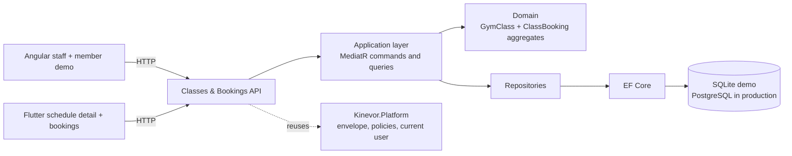
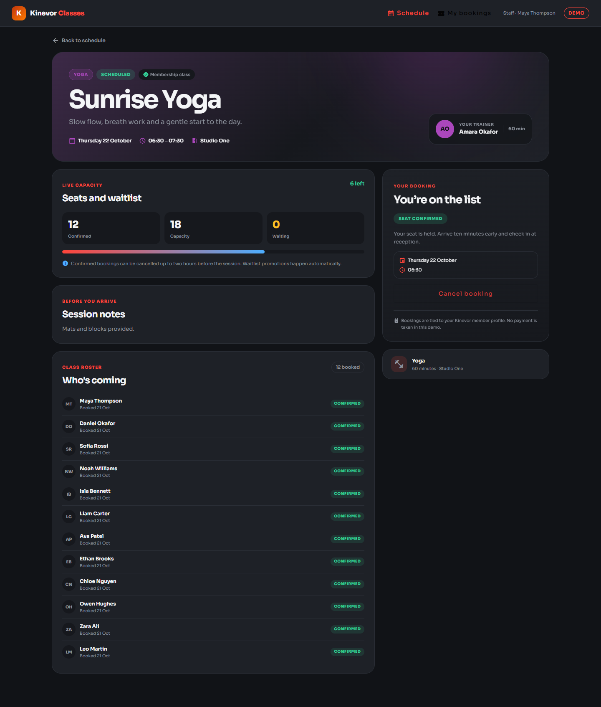
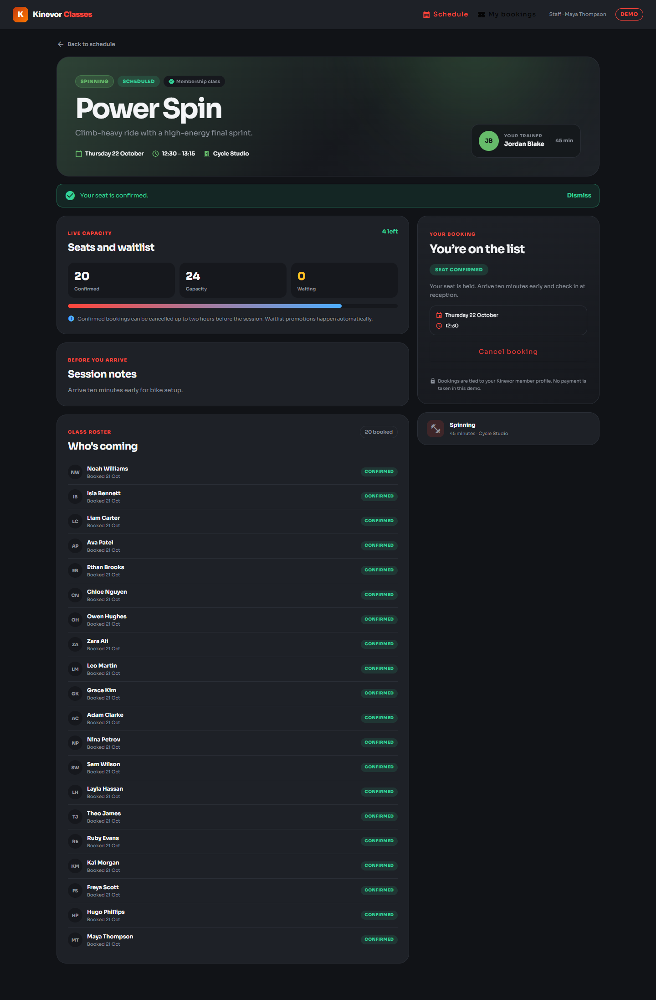
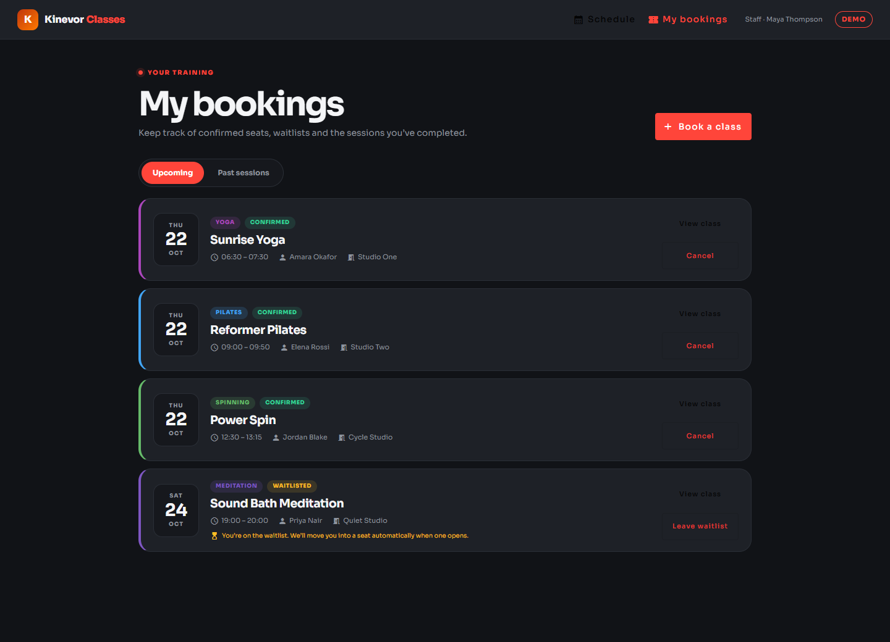
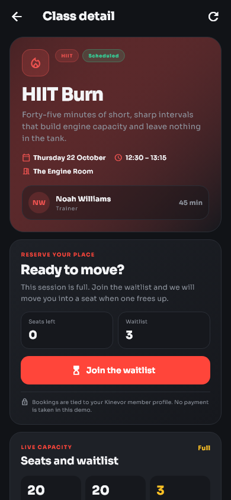
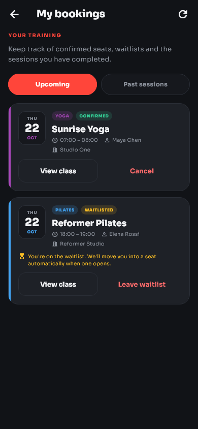
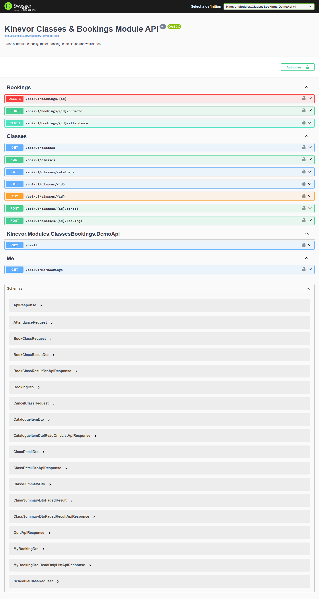

# Kinevor Classes & Bookings

Class scheduling, capacity, booking and waitlist vertical slice for the Kinevor
gym platform: a .NET 9 API, a standalone Angular library and demo, and a Flutter
package with a runnable example. Every layer can be consumed independently, and
the demo runs locally without the original Kinevor monorepo.

[](https://github.com/SoftwareDeveloper98/kinevor-classes-bookings/actions/workflows/ci.yml)
[](https://github.com/SoftwareDeveloper98/kinevor-classes-bookings/pkgs/nuget/Kinevor.Modules.ClassesBookings)
[](https://github.com/SoftwareDeveloper98/kinevor-classes-bookings/pkgs/npm/kinevor-classes-bookings-web)
[](https://flutter.dev)
[](LICENSE)


## Why this module

Classes & Bookings is the timetable and seat ledger for the gym: what is running,
who is teaching it, how many places remain and who holds each place. This
repository packages that slice for staff and member-facing applications.

- Members browse the upcoming timetable, filter by class type and see live
  capacity against a full waitlist.
- Class detail shows trainer, room, session notes, capacity and the member's own
  booking. Staff and trainers also see the confirmed roster.
- Booking is atomic: a free seat is confirmed immediately, a full class joins the
  waitlist, and a member cannot hold two active bookings for the same session.
- Confirmed seats can be cancelled up to two hours before the class. A freed seat
  automatically promotes the head of the waitlist.
- Trainers and staff schedule, update, cancel classes, promote waitlists and
  record attendance.
- Members review upcoming and past bookings through one typed contract on Angular
  and Flutter.

## Architecture



The backend is split into the module project and EF Core persistence. It depends
on the published `Kinevor.Platform.*` packages for the response envelope,
authorization policies and current-user abstractions. The Angular and Flutter
clients are thin presentation layers over a typed gateway/repository.

## Features

- Upcoming schedule with type, status and date filters, live seat counts and a
  next-session highlight.
- Catalogue grouped by class type with the next session and upcoming count.
- Class detail with capacity, waitlist, trainer, room, notes and the member's
  booking state.
- Staff and trainer roster access; member responses never leak other attendees.
- Booking, waitlist join, cancellation, automatic waitlist promotion, trainer
  promotion and attendance recording.
- Upcoming and past member bookings over `GET /api/v1/me/bookings`.
- Angular 21 standalone components, Material UI, typed gateway/facades, injectable
  providers, routes and Vitest tests.
- Flutter: injectable repository/client, schedule, detail and member bookings
  screens, golden tests and a runnable example.
- SQLite demo with twelve seeded sessions, a full class, a waitlist and completed
  history.

## Endpoints

All routes are under `/api/v1` and return the platform `ApiResponse<T>` envelope.

| Method | Route | Policy | Used by |
| --- | --- | --- | --- |
| `GET` | `/classes?type=&status=&fromDate=&toDate=&page=&pageSize=` | `MemberOrAbove` | Schedule and catalogue |
| `GET` | `/classes/catalogue` | `MemberOrAbove` | Type catalogue |
| `GET` | `/classes/{id}` | `MemberOrAbove` | Detail, capacity and roster |
| `POST` | `/classes` | `TrainerOrAbove` | Schedule a class |
| `PUT` | `/classes/{id}` | `TrainerOrAbove` | Update a class |
| `POST` | `/classes/{id}/cancel` | `TrainerOrAbove` | Cancel a class and its bookings |
| `POST` | `/classes/{id}/bookings` | `MemberOrAbove` | Book or join the waitlist |
| `DELETE` | `/bookings/{id}?reason=` | `MemberOrAbove` | Cancel a booking or leave a waitlist |
| `POST` | `/bookings/{id}/promote` | `TrainerOrAbove` | Promote a waitlisted member |
| `PATCH` | `/bookings/{id}/attendance` | `TrainerOrAbove` | Record attendance or no-show |
| `GET` | `/me/bookings?scope=upcoming\|past` | `MemberOrAbove` | Member bookings |
| `GET` | `/health` | anonymous | Demo health check |
| `GET` | `/swagger` | development only | API explorer |

Trainers may only manage their own classes, and they only see rosters for those
classes. A member sees only their own `myBooking`; the `roster` array is empty for
member requests. A filtered unique index prevents duplicate active bookings for
the same class and member.

## Screenshots

### Web

| Schedule | Class detail |
| --- | --- |
|  |  |

| Booking confirmed | My bookings |
| --- | --- |
|  |  |

### Flutter

| Schedule | Class detail |
| --- | --- |
|  |  |

| My bookings |
| --- |
|  |

### API



## Quick start

### Prerequisites

- .NET SDK 10 (the solution uses `.slnx`) and the ASP.NET Core 9 runtime.
- Node.js 22+ and npm 10+.
- Flutter 3.35+ (the repository is verified with Flutter 3.47.7).

### 1. Build the platform packages

The backend restores `Kinevor.Platform.*` from the sibling platform repository's
local package feed. Clone it next to this repository and pack it once:

```powershell
git clone https://github.com/SoftwareDeveloper98/kinevor-platform.git ..\kinevor-platform
dotnet pack ..\kinevor-platform\backend\Kinevor.Platform.slnx -c Release `
  -o ..\kinevor-platform\backend\artifacts\packages
```

If the platform packages are published to GitHub Packages, configure that source
instead and skip the local pack step.

### 2. Run the API

```powershell
dotnet restore backend\Kinevor.Modules.ClassesBookings.slnx
dotnet run --project backend\samples\Kinevor.Modules.ClassesBookings.DemoApi
```

The API listens on `http://localhost:5085`. Open
`http://localhost:5085/swagger` for the explorer. The demo creates a SQLite
database and seeds twelve sessions on first run:

| Session | Type | Capacity | Seeded state |
| --- | --- | --- | --- |
| Sunrise Yoga | Yoga | 18 | 12 booked |
| HIIT Burn | HIIT | 20 | Full with a waitlist |
| Reformer Pilates | Pilates | 12 | 8 booked |
| Power Spin | Spinning | 24 | 19 booked |
| Boxing Fundamentals | Boxing | 16 | 14 booked |
| BodyPump Strength | BodyPump | 20 | 15 booked |
| Sunset Zumba | Zumba | 22 | 11 booked |
| Aqua Reset | Aqua | 14 | 7 booked |
| Sound Bath Meditation | Meditation | 6 | Full with a waitlist |
| Mobility & Stretch | Stretching | 16 | 9 booked |
| Morning Flow | Yoga | 16 | Completed history |
| Strength Lab | CrossFit | 12 | Completed history |

Maya Thompson is the primary self-service member
(`11111111-1111-1111-1111-111111111111`) with seeded upcoming and past bookings.

The demo trusts development-only headers:

| Header | Purpose | Example |
| --- | --- | --- |
| `X-Demo-Role` | Selects the authenticated role | `Staff`, `Member`, `Trainer`, `Admin` |
| `X-Demo-Email` | Sets the current user e-mail | `staff.demo@kinevor.local` |
| `X-Demo-Member` | Binds a member identity | `11111111-1111-1111-1111-111111111111` |
| `X-Branch-Id` | Selects the branch context | branch GUID |

These headers are a demo adapter only. Never enable them in production.

### 3. Run the web demo

For local development, build the platform web package once:

```powershell
cd ..\kinevor-platform\web
npm install
npm run build
cd ..\..\kinevor-classes-bookings\web
npm run install:local
npm start
```

`npm run install:local` temporarily points the workspace at the local platform
build, installs dependencies, restores `package.json`, and removes the generated
lockfile. When the package is published to GitHub Packages, authenticate the
scope in `.npmrc` and use the normal path instead:

```powershell
cd web
npm install
npm start
```

The web demo runs at `http://localhost:4204` with routes:

- `/classes` - schedule, capacity, filters and next session
- `/classes/:id` - detail, roster, booking, waitlist and cancellation
- `/me/bookings` - upcoming and past member bookings

The demo interceptor sends the `Staff` role and Maya's member id, so the roster
and member bookings are visible together. A real host supplies its own
authentication and platform configuration.

### 4. Run the Flutter example

```powershell
cd mobile\packages\kinevor_classes_bookings
flutter pub get
cd example
flutter run -d chrome
```

The example targets `http://localhost:5085/api/v1` by default. Override it for an
emulator or remote host:

```powershell
flutter run -d chrome `
  --dart-define=KINEVOR_CLASSES_API_BASE_URL=http://localhost:5085/api/v1
```

On an Android emulator use `http://10.0.2.2:5085/api/v1`. The demo API allows the
Angular origin `http://localhost:4204`; add your host origin before running the
Flutter web example from another port.

### 5. Refresh screenshots

With both servers running:

```powershell
cd web
npm run capture:screenshots
```

The Playwright script writes the web and API images to `docs/screenshots`. It
also resets any previous Power Spin booking before taking the confirmation shot.

Regenerate the Flutter goldens and copy them into the docs folder with:

```powershell
cd mobile\packages\kinevor_classes_bookings
flutter test --update-goldens test\classes_golden_test.dart
Copy-Item test\goldens\class_schedule.png ..\..\..\docs\screenshots\mobile-schedule.png
Copy-Item test\goldens\class_detail.png ..\..\..\docs\screenshots\mobile-class-detail.png
Copy-Item test\goldens\member_bookings.png ..\..\..\docs\screenshots\mobile-my-bookings.png
```

## Testing

| Area | Command |
| --- | --- |
| Backend | `dotnet test backend\Kinevor.Modules.ClassesBookings.slnx -c Release` |
| Web unit tests | `cd web; npm test` |
| Web builds | `cd web; npm run build:all` |
| Flutter analysis | `cd mobile\packages\kinevor_classes_bookings; flutter analyze` |
| Flutter tests | `cd mobile\packages\kinevor_classes_bookings; flutter test` |

The backend suite covers domain invariants, capacity and waitlist transitions,
duplicate bookings, member/staff roster visibility, cancellation, attendance and
the demo authorization boundaries. The web suite covers the HTTP gateway and the
schedule/detail/bookings facades with Vitest. The Flutter suite covers the typed
client, schedule filtering, detail booking, member cancellation and golden
images.

## Packages

| Ecosystem | Package | Contents |
| --- | --- | --- |
| NuGet | `Kinevor.Modules.ClassesBookings` | Domain, application, API controllers and module registration |
| NuGet | `Kinevor.Modules.ClassesBookings.EntityFrameworkCore` | `ClassesBookingsDbContext`, mapping and repositories |
| npm | `@softwaredeveloper98/kinevor-classes-bookings-web` | Angular components, gateway, facades, providers and routes |
| Flutter | `kinevor_classes_bookings` | API client, repository, schedule/detail/bookings screens, theme and strings |

Install the Angular library after authenticating to GitHub Packages:

```powershell
npm install @softwaredeveloper98/kinevor-classes-bookings-web
```

Consume the Flutter package from the repository tag:

```yaml
dependencies:
  kinevor_classes_bookings:
    git:
      url: https://github.com/SoftwareDeveloper98/kinevor-classes-bookings.git
      path: mobile/packages/kinevor_classes_bookings
      ref: v0.1.0
```

Both clients use the same API contract. The Angular package expects
`@softwaredeveloper98/kinevor-platform-web` as a peer dependency.

CI restores the platform NuGet and npm packages from GitHub Packages. Publish
`kinevor-platform` `0.1.0` first, or the backend and web jobs will fail at
restore/install.

## Design decisions

- **Capacity is owned by the class.** `GymClass` tracks confirmed seats, waitlist
  size and availability, and rejects capacity changes below the confirmed count.
- **Booking is one transaction.** The booking command reserves a seat or waitlist
  position and increments counters together; unique filtering prevents duplicate
  active bookings.
- **Waitlists are ordered.** Cancellation promotes the oldest waitlisted booking
  automatically; trainers can also promote explicitly.
- **Cancellation has a boundary.** Members can release a confirmed seat up to two
  hours before the session; staff retain operational override.
- **Roster visibility is a policy decision.** Staff and the owning trainer see the
  roster; members see only their own booking.
- **Thin clients.** Angular facades own loading state; Flutter injects a
  repository so hosts can swap the HTTP implementation.
- **Demo auth is explicit.** Trust headers exist only in Development and are sent
  by the demo interceptor/client.
- **Visual contract in tests.** Playwright and Flutter goldens make layout,
  typography and icon regressions visible.

## Repository layout

```text
kinevor-classes-bookings/
  backend/
    src/Kinevor.Modules.ClassesBookings/          domain, application, API
    src/Kinevor.Modules.ClassesBookings.EntityFrameworkCore/
    samples/Kinevor.Modules.ClassesBookings.DemoApi/
    tests/Kinevor.Modules.ClassesBookings.Tests/
  web/
    projects/kinevor-classes-bookings/            Angular library
    projects/demo/                                demo host
    scripts/                                      local install + screenshots
  mobile/
    packages/kinevor_classes_bookings/            Flutter package
    packages/kinevor_classes_bookings/example/    runnable demo
  docs/
    screenshots/
  .github/workflows/
```

## Related modules

- [Kinevor Platform](https://github.com/SoftwareDeveloper98/kinevor-platform) -
  shared API, auth, i18n, notices and Angular primitives.
- [Kinevor Identity & Access](https://github.com/SoftwareDeveloper98/kinevor-identity-access)
- [Kinevor Trainers](https://github.com/SoftwareDeveloper98/kinevor-trainers)
- [Kinevor Members](https://github.com/SoftwareDeveloper98/kinevor-members)
- [Kinevor Memberships](https://github.com/SoftwareDeveloper98/kinevor-memberships)
- [Kinevor Check-ins & Access](https://github.com/SoftwareDeveloper98/kinevor-checkins-access)
- [Kinevor Payments & Billing](https://github.com/SoftwareDeveloper98/kinevor-payments-billing)
- [Kinevor Notifications](https://github.com/SoftwareDeveloper98/kinevor-notifications)
- [Kinevor Public Site](https://github.com/SoftwareDeveloper98/kinevor-public-site)
- [Kinevor Staff Dashboard](https://github.com/SoftwareDeveloper98/kinevor-staff-dashboard)

## Release Checklist

- Confirm `kinevor-platform` `v0.1.0` is published.
- Add the `KINEVOR_PACKAGES_TOKEN` repository secret.
- Push tag `v0.1.0` after CI is green.

See [PUBLISHING.md](PUBLISHING.md) for the complete release and consumer setup.

## Security

The demo role headers are intentionally insecure and exist only for local
screenshots and tests. Production hosts must use the platform authentication
stack, enforce the published policies, and keep the demo adapter disabled. Member
and trainer ids are external references; this module never accesses another
module's database. Do not commit connection strings, PATs or `.env` files.

## License

MIT. See [LICENSE](LICENSE).
